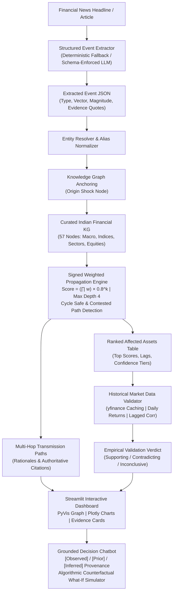

# Autonomous Financial Event Market Impact Graph

An explainable, India-focused decision-support prototype that converts financial news into structured shocks, traces signed transmission paths across a curated knowledge graph of Indian financial relationships, validates co-movements against historical market data, and explains findings through grounded evidence provenance.

> ⚠️ **MANDATORY DISCLAIMER:**  
> **Hypothesized transmission paths, not predictions.**  
> *This prototype illustrates hypothesized structural transmission channels and historical statistical co-movements. It is an explainable decision-support tool, not a stock-price prediction engine or trading system.*

---

## 1. System Architecture



---

## 2. Technology Stack

| Layer | Component | Version / Tool | Rationale |
| :--- | :--- | :--- | :--- |
| **Language** | Python | `3.11.8+` | Modern type hints, high performance, broad financial library support. |
| **Knowledge Graph** | NetworkX & PyYAML | `networkx 3.6+`, `pyyaml 6.0+` | Version-controlled, human-auditable graph definition; zero black-box databases. |
| **Propagation Engine** | In-Memory Graph Math | Pure Python & NumPy | Deterministic signed arithmetic, exponential hop decay ($0.8^k$), conflict detection. |
| **Web UI** | Streamlit & PyVis | `streamlit 1.35+`, `pyvis 0.3+` | Responsive dark-fintech layout; physics-driven interactive network exploration. |
| **Financial Charts** | Plotly | `plotly 5.22+` | Interactive dual-axis and rebased-100 time series comparison with date range sliders. |
| **Market Data** | yfinance & Pandas | `yfinance 0.2+`, `pandas 2.2+` | Daily OHLCV retrieval, persistent disk caching, percentage return lagged correlations. |
| **Schema Validation** | Pydantic | `pydantic 2.5+` | Strict type enforcement on events, nodes, edges, and validation reports. |
| **Testing** | pytest | `pytest 8.0+` | 65 automated tests covering unit math, schema failures, and end-to-end pipelines. |

---

## 3. Quickstart & Installation Guide

### Prerequisites
- **Python 3.11+** installed (`python --version`).
- Git (optional, for version control).

### Step 1: Clone or Navigate to Project Directory
```powershell
cd e:\grafin
```

### Step 2: Create and Activate Virtual Environment
On **Windows (PowerShell)**:
```powershell
# Create virtual environment
python -m venv .venv

# Activate virtual environment
.venv\Scripts\Activate.ps1
```
*(If script execution is restricted on Windows, run: `Set-ExecutionPolicy -Scope Process -ExecutionPolicy Bypass` first).*

On **macOS / Linux**:
```bash
python3 -m venv .venv
source .venv/bin/activate
```

### Step 3: Install Dependencies
```powershell
python -m pip install --upgrade pip
python -m pip install -r requirements.txt
```

### Step 4: Environment Configuration (Zero External Keys Needed)
Copy the template configuration file:
```powershell
Copy-Item .env.example .env
```
> **Note:** By default, `OFFLINE_DEMO_MODE=true` and `LLM_PROVIDER=none`. The entire application operates 100% offline with zero external API dependencies or costs.

---

## 4. Running the Application

### Option A: Launch Interactive Streamlit Dashboard
```powershell
streamlit run src/ui/app.py
```
Open your browser at `http://localhost:8501`.

### Option B: Run Standalone CLI Demo Walkthrough
```powershell
python demo.py
```
Runs a complete terminal walkthrough illustrating graph loading, event extraction, path propagation, asset ranking, market validation, and grounded chatbot synthesis.

---

## 5. Running Automated Tests

Run the complete test suite (65 tests):
```powershell
python -m pytest tests/ -v
```

Run specific test modules:
```powershell
# Core propagation engine & hand-checked math
python -m pytest tests/test_propagator.py -v

# Knowledge graph schema, loader & alias resolution
python -m pytest tests/test_graph_loader.py -v

# Market data downloader, return math & validation
python -m pytest tests/test_market_validator.py -v

# Grounded chatbot & counterfactual simulator
python -m pytest tests/test_chatbot.py -v

# Full end-to-end integration pipeline
python -m pytest tests/test_e2e.py -v
```

---

## 6. Curated Event Dataset

The system includes 6 verified India-relevant financial events in `data/sample_events.json`:

1. **Crude Oil Shock**: Brent crude surges 8% to $92/bbl following Middle East conflict (`macro_brent_crude`).
2. **RBI Policy Rate Hike**: Monetary Policy Committee raises repo rate by 50 bps to 6.50% (`macro_rbi_repo_rate`).
3. **Rupee Weakness**: USD/INR depreciates to all-time low of 83.75 (`currency_usdinr`).
4. **Food / Monsoon CPI Spike**: Headline CPI prints 7.44% on erratic monsoon distribution (`macro_india_cpi`).
5. **Bank Regulation Tightening**: RBI raises risk weights on unsecured consumer loans by 25% (`sector_banking`).
6. **Global Yields & FII Outflows**: US 10-Year Treasury yield tops 4.80%, triggering capital rotation (`macro_india_10y_yield`).

---

## 7. Five-Minute Presentation & Demo Walkthrough

1. **Ingest Event (Minute 1)**: Select `event_crude_oil_spike_2024` from the sidebar. Inspect the **Structured Event Panel** showing the parsed shock vector, severity magnitude, and direct evidence quotes.
2. **Explore Graph (Minute 2)**: Scroll to the **PyVis Interactive Network**. Point out the highlighted origin shock (`macro_brent_crude`), solid red lines to paints and aviation, solid green lines to upstream oil, and dotted indirect transmission lines.
3. **Ranked Assets (Minute 3)**: Review the **Ranked Assets Table**. Filter by sector (Paints, Aviation, Energy). Explain that `Asian Paints` and `IndiGo` rank with high-confidence negative transmission.
4. **Audit Evidence (Minute 4)**: Open the **Asset Deep Dive Panel**. Examine the hop-by-hop breakdown table and authoritative literature citations (e.g. *DGCA airline fuel bulletins*, *corporate annual reports*). Inspect the **Market Data Validation Card** showing historical correlation with Brent crude.
5. **Grounded Chatbot & Counterfactual (Minute 5)**: Click **`✈️ Why crude affects aviation?`** to see citations labeled `[Observed Fact]`, `[Curated Prior]`, and `[Inferred Impact]`. Then click **`🔄 Reverse direction (What-If)?`** to watch the algorithmic counterfactual engine re-run signed propagation with an inverted vector in real time.

---

## 8. Deployment Guide (Streamlit Community Cloud / Cloud VM)

### Deploying to Streamlit Community Cloud
1. Push your repository to GitHub:
   ```powershell
   git remote add origin https://github.com/<your-username>/grafin.git
   git push -u origin main
   ```
2. Navigate to [share.streamlit.io](https://share.streamlit.io/) and click **"New app"**.
3. Select your repository, set **Branch** to `main`, and set **Main file path** to `src/ui/app.py`.
4. In **Advanced Settings**, add any optional hosted secrets (if using live LLM features):
   ```toml
   LLM_PROVIDER = "gemini" # or "openai"
   LLM_API_KEY = "your-live-api-key"
   OFFLINE_DEMO_MODE = "false"
   ```
5. Click **Deploy**. The application will launch with full interactive graph visualizations.

---

## 9. Troubleshooting & FAQ

- **PowerShell Script Execution Error (`Activate.ps1 cannot be loaded`)**:  
  Run `Set-ExecutionPolicy -Scope Process -ExecutionPolicy Bypass` in your PowerShell window before activating `.venv`.
- **Yahoo Finance Rate Limits or Connection Timeouts**:  
  The application automatically caches downloaded data in `data/market_cache/`. Once downloaded, subsequent runs load from disk with zero network latency. If offline, the application reports `insufficient_data` without crashing.
- **PyVis Graph Not Displaying**:  
  PyVis renders HTML via an iframe. Ensure your browser permits JavaScript execution. If embedding in custom containers, ensure height is set to at least 500px.
- **Windows Emoji / Terminal Encoding (`charmap codec error`)**:  
  `demo.py` automatically configures `sys.stdout.reconfigure(encoding='utf-8')` to prevent Windows code page errors.

---

## 10. Data Source & Licensing Notes

- **Market Price Data**: Retreived via `yfinance` for educational and decision-support prototype demonstration purposes. Delayed historical daily closes; not real-time tick feeds.
- **Literature Citations**: Public reports from the Reserve Bank of India (RBI), Ministry of Statistics (MoSPI), Society of Indian Automobile Manufacturers (SIAM), Directorate General of Civil Aviation (DGCA), and listed corporate annual disclosures.
- **Software License**: Open-source under the MIT License.
